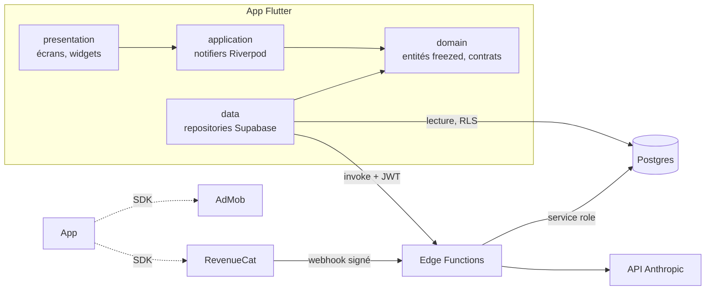

# Architecture — Journal de Langue

> Phase 3 (Mobile Architect). Décisions associées : `DECISION_LOG.md`.

## Vue d'ensemble



Règle de frontière : **l'app lit** ses données par Postgres sous RLS ; **toute écriture à
enjeu** (correction, quota, crédit, droit, récompense) passe par une Edge Function ou une
fonction SQL. L'app n'écrit directement que l'état « appris » d'un mot ; les brouillons
restent locaux.

## Stack

Flutter 3.41 / Dart 3.11 · flutter_riverpod 3 · go_router · supabase_flutter ·
freezed + json_serializable · flutter_localizations (fr, en).
Seule déviation : pas de génération de code Riverpod (ADR-009).

Plugins natifs, introduits à l'incrément qui en a besoin :

| Besoin | Plugin | Incrément |
|--------|--------|-----------|
| Brouillon local, préférences | shared_preferences | Inc-2 |
| Connexion Google / Apple | google_sign_in, sign_in_with_apple | Inc-1 |
| Achats | purchases_flutter (RevenueCat) | Inc-4 |
| Dictée / lecture | speech_to_text, flutter_tts | Inc-6 |
| PDF / partage | pdf, printing | Inc-6 |
| Publicité + consentement | google_mobile_ads | Inc-8 |

La session Supabase est stockée par `supabase_flutter` ; elle est redirigée vers le
stockage sécurisé (Keystore / Keychain) via `flutter_secure_storage` en Inc-1.

## Structure

```
lib/
├── main.dart                 # bootstrap : config, Supabase, ProviderScope
├── app.dart                  # MaterialApp.router, thème, localisation
├── core/
│   ├── config/               # AppConfig lu depuis --dart-define
│   ├── errors/               # Failure (sealed), mapping des erreurs
│   ├── supabase/             # provider du client
│   └── theme/                # tokens, ThemeData clair / sombre
├── routing/                  # go_router, redirection selon la session
├── l10n/                     # app_fr.arb, app_en.arb
├── shared/                   # widgets et utilitaires sans dépendance aux features
└── features/
    ├── auth/  onboarding/  journal/  correction/  vocabulary/  history/
    ├── exercises/  stats/  billing/  ads/  voice/  export/  exam/
    └── <feature>/{presentation,application,domain,data}/
```

Une feature ne crée que les couches dont elle a besoin. `shared` et `core` ne dépendent
d'aucune feature ; pas de dépendance circulaire entre features (`billing` expose les droits
que les autres lisent).

## Navigation

go_router, une redirection globale pilotée par l'état de session et de profil :

| Route | Écran | Accès |
|-------|-------|-------|
| `/sign-in`, `/sign-up` | Authentification | déconnecté |
| `/onboarding` | Choix de la langue | connecté sans langue |
| `/` (onglets) | Journal · Historique · Réviser · Progrès · Profil | connecté |
| `/correction/:entryId` | Correction d'un journal | connecté |
| `/paywall` | Offres | connecté |
| `/exam` | Simulation d'examen | connecté, pack disponible |

Barre d'onglets inférieure (`StatefulShellRoute`), chaque onglet garde sa pile.

## État

Riverpod 3, providers déclarés à la main. `AsyncValue` pour tout l'asynchrone. Un `Notifier` par
écran porteur d'actions ; les données lues sont des providers `autoDispose`. Les droits de
l'utilisateur (`Entitlements`) sont un provider unique, source de vérité = serveur.

## Hors ligne

Pas de base locale ni de synchronisation : la valeur de l'app (correction) exige le réseau.
Seul le brouillon du journal est conservé localement. Les écrans de lecture affichent un
état d'erreur avec « Réessayer ».

## Configuration, environnements, secrets

- Valeurs publiques injectées à la compilation par `--dart-define-from-file=env/<env>.json`
  (`SUPABASE_URL`, `SUPABASE_PUBLISHABLE_KEY`, puis clés publiques RevenueCat et identifiants AdMob).
- Deux environnements : `dev` (Supabase local dans Docker) et `prod`. Pas de flavors natifs
  tant qu'un seul identifiant d'application suffit.
- Secrets (clé Anthropic, clé service Supabase, secret du webhook) : uniquement dans les
  secrets des Edge Functions. Jamais dans le dépôt ni dans le binaire.
- `env/*.json` est ignoré par Git ; `env/example.json` documente les clés.

## Environnement de développement (ADR-037)

| Élément | Où | Commande |
|---------|----|----------|
| Postgres, Auth, Edge Functions, Studio | Docker (Supabase CLI) | `supabase start` |
| Analyse, tests, génération de code, compilation | Poste (Flutter 3.41.7) | `flutter analyze`, `flutter test`, `flutter build apk` |
| Exécution sur émulateur ou appareil | Poste | `flutter run --dart-define-from-file=env/dev.json` |

L'émulateur Android joint le Supabase local par `http://10.0.2.2:55321`.

## Sécurité (résumé)

RLS sur toutes les tables ; JWT vérifié dans chaque Edge Function ; quotas et débits
atomiques en SQL ; webhook RevenueCat authentifié et idempotent ; texte utilisateur traité
comme donnée dans les prompts ; aucune donnée d'identité envoyée à l'IA.

## Permissions

| Permission | Quand | Justification |
|------------|-------|---------------|
| Internet | toujours | API |
| Micro, reconnaissance vocale | première dictée (Inc-6) | dictée du journal |
| Identifiant publicitaire | Inc-8, après consentement | publicité |
