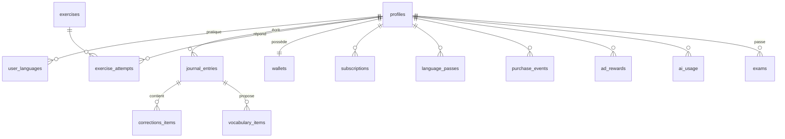

# Modèle de données

> Phase 3 (Database Architect). Les migrations sont créées dans `supabase/migrations/` à
> l'incrément qui introduit chaque table, pour que chaque migration soit testée avec sa
> fonctionnalité. Ce document est la cible.

## Types énumérés

`language_code` (en, es, de, fr) · `entry_status` (pending, corrected, failed) ·
`correction_level` (basic, advanced) · `correction_source` (plan, credit, reward) ·
`ad_reward_kind` (correction, exercises) ·
`error_category` (spelling, grammar, conjugation, vocabulary, register, phrasing, punctuation) ·
`plan` (weekly, monthly, annual).

## Tables

| Table | Colonnes principales | Incrément |
|-------|----------------------|-----------|
| `profiles` | `id` (= auth.users), `created_at` | Inc-1 |
| `user_languages` | `user_id`, `language`, `is_active`, `activated_at` ; clé (user, language) | Inc-1 |
| `journal_entries` | `id`, `user_id`, `language`, `entry_date`, `original_text`, `corrected_text`, `sentence_count`, `idempotency_key` (unique par user), `created_at`, `corrected_at` (null = correction en cours), `level` (`basic` ou `advanced`, Inc-5) ; `source` (`plan`, `credit` en Inc-7, `reward` en Inc-8) : ce qui paie la correction | Inc-2 |
| `correction_items` | `entry_id`, `position` (clé), `original`, `corrected`, `category`, `explanation` | Inc-2 |
| `ai_usage` | `id`, `user_id`, `feature`, `model`, `input_tokens`, `output_tokens`, `created_at` | Inc-2 |
| `vocabulary_items` | `id`, `user_id`, `entry_id`, `language`, `term`, `translation`, `example`, `learned_at`, `created_at` ; unique (user, langue, terme sans casse) | Inc-3 |
| `subscriptions` | `user_id` (PK), `plan`, `expires_at`, `in_trial`, `last_event_at`, `updated_at` | Inc-4 |
| `purchase_events` | `event_id` (PK, fourni par RevenueCat), `user_id`, `type`, `product_id`, `event_at`, `received_at` | Inc-4 |
| `exercises` | `id`, `language`, `category`, `ui_locale`, `question`, `options` (4 choix), `answer_index`, `explanation`, `created_at` — réserve partagée entre utilisateurs (ADR-024) | Inc-5 |
| `exercise_attempts` | `id`, `user_id`, `exercise_id`, `attempt_date`, `choice`, `is_correct`, `created_at` — sert aussi de compteur du jour | Inc-5 |
| `sentence_rewrites` | `id`, `entry_id`, `sentence`, `polite`, `casual`, `professional`, `created_at` ; unique (journal, phrase) | Inc-5 |
| `wallets` | `user_id` (PK), `correction_credits` (≥ 0), `exam_credits` (≥ 0), `ads_removed`, `updated_at` | Inc-7 |
| `language_passes` | `user_id`, `language` (clé), `expires_at` ; prolongé par un nouvel achat | Inc-7 |
| `one_time_purchases` | `transaction_id` (PK, fourni par le store), `user_id`, `product_id`, `quantity`, `purchased_at`, `refunded_at` | Inc-7 |
| `exams` | `id`, `user_id`, `language`, `level` (A2 à C1), `ui_locale`, `status` (`preparing`, `in_progress`, `grading`, `graded`), `prompt`, `answer` (brouillon puis copie), `result` (jsonb), `created_at`, `updated_at`, `graded_at` ; une seule simulation non terminée par utilisateur | Inc-7 |
| `ad_rewards` | `transaction_id` (PK, fourni par AdMob), `user_id`, `kind` (`correction` ou `exercises`), `units` (1 ou 3), `remaining`, `granted_on` (jour UTC), `created_at` ; unique (user, kind, granted_on) : une récompense de chaque sorte par jour (ADR-031) | Inc-8 |
| `ai_model_prices` | `model` (PK), `input_usd_per_mtok`, `output_usd_per_mtok` : prix publics servant au coût de l'IA (ADR-032) | Inc-9 |
| `ai_content_reports` | `id`, `user_id` (`set null` à la suppression du compte), `kind` (`correction`, `exercise`, `exam`), `target_id`, `comment` (500 caractères au plus), `created_at` (ADR-034) | Inc-9 |

Toutes les clés sont des `uuid`, les dates des `timestamptz`, les FK en `on delete cascade`
depuis `profiles` (la suppression du compte efface tout).

## Règles d'accès (RLS activée sur toutes les tables)

| Table | select | insert / update / delete par l'app |
|-------|--------|------------------------------------|
| `profiles` | sa ligne | aucun |
| `user_languages` | ses lignes | aucun (RPC `activate_language`, `deactivate_language`) |
| `journal_entries`, `correction_items` | ses lignes ; en gratuit, restreint aux 4 derniers jours | aucun |
| `vocabulary_items` | ses lignes | update de `learned_at` uniquement |
| `subscriptions`, `wallets`, `language_passes`, `exams`, `exercise_attempts` | ses lignes | aucun |
| `exercises`, `sentence_rewrites` | aucun accès direct (servis par Edge Function ; la bonne réponse d'un exercice n'est rendue qu'après la réponse) | aucun |
| `ai_usage`, `purchase_events`, `one_time_purchases`, `ad_rewards`, `ai_model_prices`, `ai_content_reports` | aucun (`ad_rewards` est résumée par `get_ad_status`) | aucun (signalement par `report_ai_content`) |

Les écritures passent par des fonctions `security definer` appelées par les Edge Functions
avec le rôle service : `reserve_correction`, `complete_correction`, `release_correction`,
`reserve_rewrite`, `save_rewrite`, `pick_exercises`, `add_exercises`,
`apply_store_event` (abonnements et achats uniques), `reserve_exam`, `start_exam`,
`release_exam`, `claim_exam_grading`, `complete_exam`, `release_exam_grading`,
`grant_ad_reward`. `activate_language`, `deactivate_language`, `get_wallet`,
`save_exam_draft`, `get_ad_status`, `report_ai_content`, `get_history_overview`,
`get_languages`, `delete_account`, `get_entitlements`, `answer_exercise` et `get_stats`
sont appelables par l'utilisateur connecté et n'agissent que sur ses données.
`get_history_overview` rend aussi le nombre de journaux corrigés : l'app sait, sans
charger l'historique (lu par pages de 20), si elle peut proposer les offres (ADR-035).

Publicités (ADR-030, ADR-031) : `ads_enabled(user)` est vrai pour un compte gratuit,
sans l'achat « sans publicité », inscrit depuis plus de 14 jours. Une correction offerte
par une vidéo passe après le quota et les crédits (`reserve_correction`) ; les
exercices offerts s'ajoutent à la limite du jour (`pick_exercises`, `answer_exercise`).

Langues (ADR-025) : `plan_limits` donne `max_languages` (1 en gratuit, 3 en
hebdomadaire ou mensuel, 4 en annuel). `usable_languages(user)` rend les langues
actives les plus récemment choisies dans cette limite ; correction et exercices
exigent une langue utilisable (`is_usable_language`). Statistiques (ADR-026) :
`get_stats(langue, date)` calcule la série et les jours écrits de la semaine en cours (du lundi à la date donnée, toutes langues confondues) et, en Premium, les détails : mots appris, fautes par type et journaux de la langue par semaine sur 8 semaines (`weekly_journals`, ADR-040).

La limite d'historique gratuit est dans la policy `select` (et non dans l'app) : elle
compare `entry_date` à `history_start_date()`. `get_history_overview()` indique à l'app
combien de journaux plus anciens sont conservés. Les droits Premium lèveront cette limite
en Inc-4.

## Jour civil de l'utilisateur

Le quota est « par jour » dans le fuseau de l'utilisateur. L'app envoie sa date locale ;
`reserve_correction` l'accepte seulement si c'est « aujourd'hui » dans au moins un fuseau
(UTC-12 à UTC+14) et si elle ne recule pas par rapport au dernier journal. Aucun fuseau
n'est stocké. Gain maximal pour un tricheur : une correction d'avance, une seule fois.

## Limites de l'offre

`plan_limits(user)` est la source unique. Gratuit : 7 phrases, 1000 caractères,
1 correction et 5 mots de vocabulaire par jour, 4 jours d'historique. Premium (abonnement
non expiré) : 40 phrases, 6000 caractères, 30 corrections par jour, vocabulaire et
historique sans limite. `get_entitlements(date)` les expose à l'app avec le nombre de corrections
restantes ; l'app n'a aucune constante de limite.

## Index

- `journal_entries (user_id, language, entry_date desc)` — historique, quota du jour, série.
- `correction_items (entry_id)` ; `vocabulary_items (user_id, language, created_at desc)`.
- `exercises (language, category, ui_locale)` — réserve ;
  `exercise_attempts (user_id, attempt_date)` — limite du jour ;
  `sentence_rewrites (entry_id, md5(sentence))` unique — pas de second appel.
- `ai_usage (user_id, created_at)` — coût par utilisateur.

## Vues de suivi (Inc-9, ADR-032)

Lisibles uniquement avec le rôle service (éditeur SQL du tableau de bord Supabase) :

- `v_ai_cost_per_user` : par mois (UTC) et par utilisateur, appels, tokens, coût en
  dollars et appels à un modèle sans prix connu (`unpriced_calls`).
- `v_ai_cost_per_month` : utilisateurs actifs (au moins un appel à l'IA), coût total et
  coût par utilisateur actif.
- `v_retention_d7` : par semaine d'inscription, inscrits et part de ceux qui ont écrit un
  journal ou fait un exercice le 7e jour ; une semaine n'apparaît qu'une fois tous ses
  7e jours passés.

Exemple : `select * from v_ai_cost_per_month order by month desc;`

## Données personnelles

Conservées : e-mail (Auth), journaux, corrections, vocabulaire, historique d'achats
(identifiants de transaction). Envoyé à l'IA : le texte du journal et la langue, sans
identifiant. Suppression de compte : cascade complète + suppression de l'utilisateur Auth.
