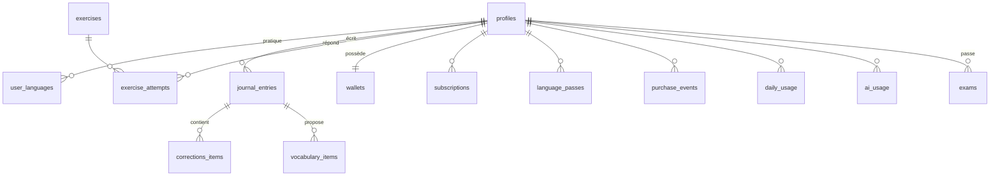

# Modèle de données

> Phase 3 (Database Architect). Les migrations sont créées dans `supabase/migrations/` à
> l'incrément qui introduit chaque table, pour que chaque migration soit testée avec sa
> fonctionnalité. Ce document est la cible.

## Types énumérés

`language_code` (en, es, de, fr) · `entry_status` (pending, corrected, failed) ·
`correction_level` (basic, advanced) · `correction_source` (free, credit, reward, premium) ·
`error_category` (spelling, grammar, conjugation, vocabulary, register, phrasing, punctuation) ·
`plan` (weekly, monthly, annual).

## Tables

| Table | Colonnes principales | Incrément |
|-------|----------------------|-----------|
| `profiles` | `id` (= auth.users), `created_at` | Inc-1 |
| `user_languages` | `user_id`, `language`, `is_active`, `activated_at` ; clé (user, language) | Inc-1 |
| `journal_entries` | `id`, `user_id`, `language`, `entry_date`, `original_text`, `corrected_text`, `sentence_count`, `idempotency_key` (unique par user), `created_at`, `corrected_at` (null = correction en cours) ; `level` et `source` arriveront avec les offres payantes | Inc-2 |
| `correction_items` | `entry_id`, `position` (clé), `original`, `corrected`, `category`, `explanation` | Inc-2 |
| `daily_usage` | `user_id`, `usage_date`, `vocab_items`, `exercises`, `reward_corrections`, `reward_exercises` ; PK (user, date). Le quota de corrections se lit dans `journal_entries` | Inc-3 |
| `ai_usage` | `id`, `user_id`, `feature`, `model`, `input_tokens`, `output_tokens`, `created_at` | Inc-2 |
| `vocabulary_items` | `id`, `user_id`, `entry_id`, `language`, `term`, `translation`, `example`, `learned_at`, `created_at` | Inc-3 |
| `subscriptions` | `user_id` (PK), `plan`, `expires_at`, `in_trial`, `updated_at` | Inc-4 |
| `purchase_events` | `event_id` (PK, fourni par RevenueCat), `user_id`, `product_id`, `type`, `received_at` | Inc-4 |
| `exercises` | `id`, `language`, `category`, `ui_locale`, `payload` (jsonb), `created_at` — cache partagé | Inc-5 |
| `exercise_attempts` | `id`, `user_id`, `exercise_id`, `correct`, `created_at` | Inc-5 |
| `wallets` | `user_id` (PK), `correction_credits` (≥ 0), `exam_credits` (≥ 0), `ads_removed` | Inc-7 |
| `language_passes` | `id`, `user_id`, `language`, `expires_at` | Inc-7 |
| `exams` | `id`, `user_id`, `language`, `prompt`, `answer`, `result` (jsonb), `status`, `created_at` | Inc-7 |

Toutes les clés sont des `uuid`, les dates des `timestamptz`, les FK en `on delete cascade`
depuis `profiles` (la suppression du compte efface tout).

## Règles d'accès (RLS activée sur toutes les tables)

| Table | select | insert / update / delete par l'app |
|-------|--------|------------------------------------|
| `profiles` | sa ligne | aucun |
| `user_languages` | ses lignes | aucun (RPC `activate_language`) |
| `journal_entries`, `correction_items` | ses lignes ; en gratuit, restreint aux 4 derniers jours | aucun |
| `vocabulary_items` | ses lignes | update de `learned_at` uniquement |
| `daily_usage`, `subscriptions`, `wallets`, `language_passes`, `exams`, `exercise_attempts` | ses lignes | aucun |
| `exercises` | aucun accès direct (servi par Edge Function) | aucun |
| `ai_usage`, `purchase_events` | aucun | aucun |

Les écritures passent par des fonctions `security definer` appelées par les Edge Functions
avec le rôle service : `reserve_correction`, `complete_correction`, `release_correction`,
`apply_purchase`, `claim_reward`. `activate_language`, `delete_account`, `get_entitlements`
et `get_stats` sont appelables par l'utilisateur connecté et n'agissent que sur ses données.

La limite d'historique gratuit est dans la policy `select` (et non dans l'app) : elle
compare `entry_date` à la date du jour moins 3 jours quand l'utilisateur n'a pas de droit
Premium actif.

## Jour civil de l'utilisateur

Le quota est « par jour » dans le fuseau de l'utilisateur. L'app envoie sa date locale ;
`reserve_correction` l'accepte seulement si c'est « aujourd'hui » dans au moins un fuseau
(UTC-12 à UTC+14) et si elle ne recule pas par rapport au dernier journal. Aucun fuseau
n'est stocké. Gain maximal pour un tricheur : une correction d'avance, une seule fois.

## Limites de l'offre

`plan_limits()` est la source unique : 7 phrases, 1000 caractères, 1 correction par jour
en gratuit. `get_entitlements(date)` les expose à l'app avec le nombre de corrections
restantes ; l'app n'a aucune constante de limite.

## Index

- `journal_entries (user_id, language, entry_date desc)` — historique, quota du jour, série.
- `correction_items (entry_id)` ; `vocabulary_items (user_id, language, created_at desc)`.
- `exercises (language, category, ui_locale)` — cache.
- `ai_usage (user_id, created_at)` — coût par utilisateur.

## Vues de suivi (Inc-9)

`v_ai_cost_per_user` (tokens par utilisateur et par mois) et `v_retention_d7`, lisibles
uniquement avec le rôle service (tableau de bord Supabase).

## Données personnelles

Conservées : e-mail (Auth), journaux, corrections, vocabulaire, historique d'achats
(identifiants de transaction). Envoyé à l'IA : le texte du journal et la langue, sans
identifiant. Suppression de compte : cascade complète + suppression de l'utilisateur Auth.
