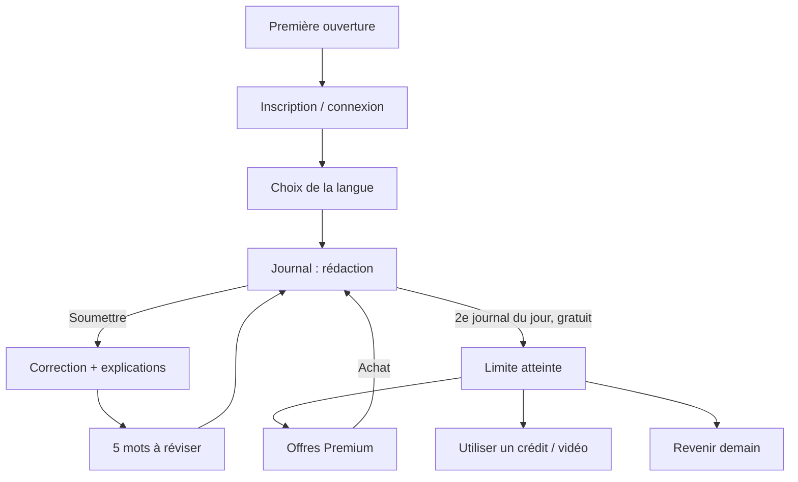

# Parcours et écrans

> Phase 3 (UI/UX). Les wireframes sont indicatifs ; les textes définitifs sont dans `lib/l10n/`.

## Parcours principal (§6 de l'INTAKE)



L'écran d'offres n'est jamais montré avant qu'une première correction soit terminée.

## Onglets

`Journal` · `Historique` · `Réviser` · `Progrès` · `Profil`

## Écrans

### Journal (accueil)

Mise en page du brand kit (ADR-019).
```
┌──────────────────────────────┐
│ Mon journal        [Anglais] │   langue active
│                              │
│ Bonjour !                    │
│ Une phrase à la fois.        │
│ Prends quelques minutes…     │
│ ┌──────────────────────────┐ │
│ │ Mon journal du jour      │ │   carte blanche
│ │ ┌──────────────────────┐ │ │
│ │ │ Aujourd'hui, j'ai…   │ │ │   saisie, brouillon automatique
│ │ └──────────────────────┘ │ │
│ │ ▓▓▓▓▓░░░░░  3 / 7 phrases│ │   progression en corail
│ │ [       Corriger       ] │ │
│ └──────────────────────────┘ │
└──────────────────────────────┘
```
- Limite de phrases dépassée : barre et texte en rouge, bouton désactivé, explication.
- Correction du jour déjà faite : carte « Ton journal est corrigé. Découvre ce que tu as
  appris. » avec accès à la correction, puis rappel « reviens demain ». Les options
  Premium, crédits et vidéo s'y ajouteront (Inc-4, 7, 8).
- Hors ligne ou panne : la saisie reste possible et conservée ; l'envoi affiche l'erreur
  et précise que rien n'est débité.
- La série de jours s'affiche sous le titre dès le premier jour ; Premium ajoute la
  dictée (micro dans la carte du journal) et, s'il pratique plusieurs langues, une
  puce pour changer la langue du journal (Inc-6).
- Pas de publicité sur cet écran pendant la saisie (clavier ouvert ou texte non vide).

### Correction
```
┌──────────────────────────────┐
│ ← Correction                 │
│ Ta version                   │
│  Today I ~~have went~~ to…   │
│ Version corrigée        🔊(P)│
│  Today I __went__ to…        │
│ ── 2 points à retenir ─────  │
│ ▸ have went → went           │
│   Le prétérit s'emploie…     │
│   [Reformuler (P)]           │
│ ── À réviser ─────────────   │
│  • grocery store — épicerie  │
│ [      Terminer      ]       │
└──────────────────────────────┘
```
- Chargement : squelette + « Claude lit ton journal… » (jusqu'à 15 s).
- Erreur : « La correction n'a pas abouti. Ta correction du jour n'a pas été utilisée. » + Réessayer.
- Aucune faute : message de félicitation, vocabulaire quand même proposé.
- Gratuit : explications brèves ; les éléments Premium sont visibles et verrouillés.
- Interstitiel éventuel uniquement après « Terminer ».

### Historique
Liste par date (langue, extrait, nombre de fautes). Gratuit : au-delà de 4 jours, lignes
verrouillées avec invitation Premium. Vide : « Ton premier journal apparaîtra ici. »

### Réviser
Deux sections : **Vocabulaire** (cartes terme / traduction / exemple, bouton « Appris ») et
**Exercices** (une question à la fois, retour immédiat). Vide : « Corrige un journal pour
obtenir des mots à réviser. » Aucune publicité pendant une révision.

### Progrès
Série de jours (visible par tous). Mots appris, erreurs fréquentes par catégorie, évolution :
Premium, sinon aperçu verrouillé. Export PDF (Premium).

### Profil
Langues (ajout selon l'offre), offre actuelle et solde de crédits,
« Gérer mon abonnement » (lien store), « Restaurer mes achats », boutique (packs),
confidentialité et conditions, déconnexion, suppression du compte (double confirmation).

### Offres (paywall)
```
┌──────────────────────────────┐
│ ✕   Continue ta série        │
│ ✓ Journaux illimités         │
│ ✓ Corrections détaillées …   │
│ ┌ Annuel — le plus avantageux┐│
│ │ 29,99 €/an (2,50 €/mois)   ││
│ └────────────────────────────┘│
│ ┌ Mensuel  4,99 €/mois ─────┐│
│ ┌ Hebdo    2,99 €/semaine ──┐│
│ [ Essayer 3 jours gratuits ] │
│ Puis 29,99 €/an, renouvelé   │
│ automatiquement. Annulable à │
│ tout moment dans le store.   │
│ Restaurer · CGU · Confident. │
└──────────────────────────────┘
```
Les prix affichés sont ceux renvoyés par le store. La croix de fermeture est toujours visible.

### Authentification
Connexion, inscription, saisie du code reçu par e-mail, mot de passe oublié. Google et
Apple en Inc-1b ; liens vers les textes légaux en Inc-9. L'interface suit la langue du
téléphone (français ou anglais).

### Onboarding
Une seule question : « Quelle langue veux-tu apprendre ? » (4 choix), puis l'écran Journal.
