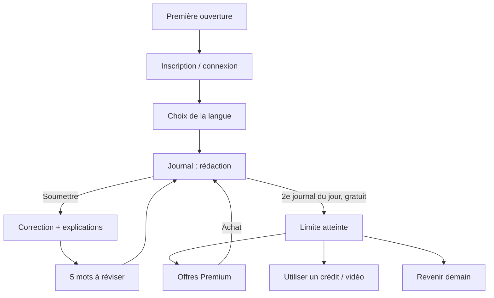

# Parcours et écrans

> Phase 3 (UI/UX). Les wireframes sont indicatifs ; les textes définitifs sont dans `lib/l10n/`.

## Parcours principal (§6 de l'INTAKE)



L'écran d'offres ne s'ouvre jamais de lui-même avant qu'une première correction soit
terminée, et aucun rappel ne le propose avant ; seul le Profil y mène dès le premier jour
(ADR-040).

## Onglets

`Journal` · `Historique` · `Réviser` · `Progrès` · `Profil`, dans une barre flottante aux
coins arrondis (ADR-038).

## Écrans

### Journal (accueil)

Mise en page du brand kit (ADR-019), refaite d'après la maquette (ADR-038).
```
┌──────────────────────────────┐
│▓Jeudi 20 novembre [Anglais ▾]▓│   aplat vert : date, langue active
│▓Bonjour !                    ▓│
│▓Une phrase à la fois.        ▓│
│▓┌─🔥 3 jours de suite ──────┐▓│   série
│▓│  (L)(M)(M)(J) V  S  D     │▓│   jours écrits cette semaine
│▓└──────────────────────────┘▓│
│ ╰────────────────────────────╯ │
│ ┌──────────────────────────┐ │
│ │ Ton journal           🎤(P)│ │   carte blanche, dictée Premium
│ │ Écris en anglais, sans…  │ │
│ │ ┌──────────────────────┐ │ │
│ │ │ Aujourd'hui, j'ai…   │ │ │   saisie, brouillon automatique
│ │ └──────────────────────┘ │ │
│ │ ▓▓▓▓▓░░░░░░░░░░░░░░░░░░░ │ │   progression en corail
│ │ 3 phrases sur 7  120/1000│ │   phrases et caractères
│ │ [ Corriger mon journal → ]│ │
│ │ 1 correction disponible  │ │
│ └──────────────────────────┘ │
│ ╭ Journal Hist. Rév. Prog. ╮ │   barre d'onglets flottante
└──────────────────────────────┘
```
- Limite de phrases dépassée : barre et texte en rouge, bouton désactivé, explication.
- Correction du jour déjà faite : carte « Ton journal est corrigé. Découvre ce que tu as
  appris. » avec accès à la correction, puis rappel « reviens demain ». Les options
  Premium, crédits et vidéo s'y ajouteront (Inc-4, 7, 8).
- Hors ligne ou panne : la saisie reste possible et conservée ; l'envoi affiche l'erreur
  et précise que rien n'est débité.
- La série de jours et la semaine d'écriture s'affichent dans l'en-tête ; Premium ajoute
  la dictée (micro dans la carte du journal) et, s'il pratique plusieurs langues, une
  puce pour changer la langue du journal (Inc-6).
- Pas de publicité sur cet écran pendant la saisie (clavier ouvert ou texte non vide).

### Correction
```
┌──────────────────────────────┐
│ (←)      Correction       (⚑)│   boutons ronds : retour, signaler
│▓(2) 2 fautes corrigées       ▓│   bilan sur l'aplat vert
│▓    Chaque erreur est une…   ▓│
│ [Ta version|Version corrigée]│   bascule, corrigée par défaut
│ ┌──────────────────────────┐ │
│ │ Today I __went__ to… 🔊(P)│ │
│ └──────────────────────────┘ │
│ À retenir                    │
│ ┌ Conjugaison         🔊(P)─┐ │   une carte par faute, écoute
│ │ ~~have went~~  went       │ │   de la phrase corrigée
│ │ Le prétérit s'emploie…    │ │
│ Reformuler une phrase  🔒/›  │
│ [grocery store · épicerie]   │   mots en pastilles corail
│ [        Terminé          ]  │   toujours visible en bas
└──────────────────────────────┘
```
- Chargement : squelette + « Claude lit ton journal… » (jusqu'à 15 s).
- Erreur : « La correction n'a pas abouti. Ta correction du jour n'a pas été utilisée. » + Réessayer.
- Aucune faute : message de félicitation, vocabulaire quand même proposé.
- Gratuit : explications brèves ; les éléments Premium sont visibles et verrouillés.
- Interstitiel éventuel uniquement après « Terminer ».

### Historique
Cartes par date (pastille jour et mois, jour de la semaine, extrait, étiquette du nombre
de fautes). Gratuit : au-delà de 4 jours, carte corail « journaux conservés » avec
invitation Premium. Vide : « Ton premier journal apparaîtra ici. »

### Réviser
En tête, deux tuiles : **Exercices** (aplat vert ; 3 questions par jour en gratuit, 20
en Premium, retour immédiat) et **Examen blanc** (corail doux, noté sur 20 avec un plan ;
toujours visible, sa boutique n'est proposée qu'après une première correction).
Ensuite la **carte du jour** : jusqu'à 5 mots à réviser, un à la fois (« Carte du jour ·
1 sur 5 », le mot, son exemple) ; la traduction s'affiche à la demande, « Je sais » le
marque appris, « À revoir » le garde ; une fois le paquet fini, « Revoir d'autres
cartes » s'il en reste. Puis **Tes mots** : mots appris sur le total, barre de
progression, puis les mots (terme et traduction) groupés dans une carte, chacun avec un
bouton rond « Appris » ; l'exemple est sur la carte du jour. Vide : « Corrige un journal pour obtenir des
mots à réviser. » Aucune publicité pendant une révision.

### Progrès
Série de jours sur l'aplat vert, le chiffre en grand (visible par tous), et journaux
écrits. En Premium : journaux par semaine sur 8 semaines (une colonne par semaine, vides
comprises, la semaine en cours en vert profond, sa date sous chaque colonne), mots appris
et « Tes fautes fréquentes » par type ; sinon carte corail « Statistiques détaillées ».
Export PDF (Premium, onglet Réviser).

### Profil
En-tête : initiale et e-mail du compte. Carte verte de l'offre : « Offre gratuite ·
1 correction par jour », ce que Premium ajoute et « Découvrir Premium » ; pour un abonné,
son offre, l'échéance et « Gérer mon abonnement ». Puis **Langues** (langues actives
rappelées à droite), **Achats** (solde des crédits ; restauration des achats) et
**Confidentialité** (feuille : conditions, politique de confidentialité, choix
publicitaires là où ils sont exigés, à propos) ; enfin déconnexion et suppression du
compte (double confirmation), sans pastille.

### Offres (paywall)
```
┌──────────────────────────────┐
│ ✕   Continue ta série        │
│ ✓ Journaux illimités         │
│ ✓ Corrections détaillées …   │
│ ┌ Annuel — le plus avantageux┐│
│ │ 29,99 €/an (2,50 €/mois)   ││
│ └────────────────────────────┘│
│ ┌ Mensuel  4,99 €/mois ─────┐│
│ ┌ Hebdo    2,99 €/semaine ──┐│
│ [ Essayer 3 jours gratuits ] │
│ Puis 29,99 €/an, renouvelé   │
│ automatiquement. Annulable à │
│ tout moment dans le store.   │
│ Restaurer · CGU · Confident. │
└──────────────────────────────┘
```
Les prix affichés sont ceux renvoyés par le store. La croix de fermeture est toujours visible.

### Accueil
Première page sans compte, et après une déconnexion : logo, « Journal de Langue » et la
signature sur l'aplat vert ; dessous, « Apprends en écrivant » et trois atouts (quelques
phrases par jour, chaque faute corrigée et expliquée, les mots du jour à réviser), puis
**Créer mon compte** et **J'ai déjà un compte**.

### Authentification
Connexion, inscription, saisie du code reçu par e-mail, mot de passe oublié : titre sur un
en-tête vert arrondi, formulaire sur l'ivoire. Connexion et inscription se remplacent
l'une l'autre ; le retour ramène à l'accueil. Google et Apple en Inc-1b ; liens vers les textes légaux à l'inscription.
L'interface suit la langue du téléphone (français ou anglais).

### Onboarding
Une seule question : « Quelle langue veux-tu apprendre ? » (4 choix), puis l'écran Journal.
