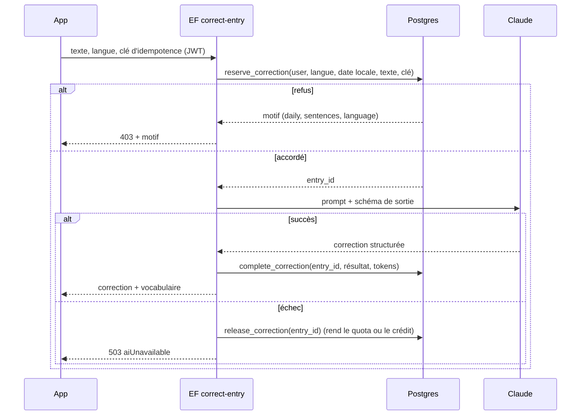
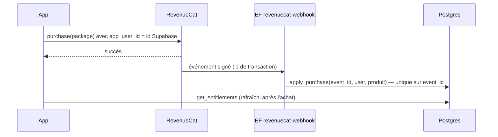

# Conception détaillée

> Phase 3 (System Design). Complète `docs/architecture.md`.

## Erreurs du domaine

```dart
sealed class Failure {
  network        // pas de réseau, délai dépassé — réessayable
  unauthorized   // session expirée
  quotaExceeded  // limite de l'offre atteinte (motif : daily, sentences, languages…)
  premiumRequired
  invalidInput   // texte vide, trop long, mauvaise langue
  aiUnavailable  // IA en échec — aucun débit, réessayable
  unexpected
}
```

Les repositories convertissent toute exception en `Failure` ; la présentation ne voit
jamais d'exception Supabase.

## Contrats des repositories

| Repository | Méthodes | Source |
|------------|----------|--------|
| `AuthRepository` | `watchUserId`, `signUp`, `confirmSignUp`, `resendSignUpCode`, `signIn`, `requestPasswordReset`, `resetPassword`, `signOut`, `deleteAccount` (Google / Apple en Inc-1b) | Auth + RPC `delete_account` |
| `LanguageRepository` | `activeLanguages`, `activate` | Postgres + RPC `activate_language` |
| `EntitlementsRepository` | `watch()` → `Entitlements` (offre, limites, crédits, restant du jour) | RPC `get_entitlements` |
| `JournalRepository` | `allowance(day)`, `entryOfDay(day)`, `entry(id)`, `submit(text, language, uiLocale, day, idempotencyKey)` | RPC `get_entitlements`, Postgres, EF `correct-entry` |
| `JournalDraftStore` | `load`, `save`, `clearAll` | stockage sécurisé de l'appareil |
| `HistoryRepository` | `list(language, page)`, `get(entryId)` | Postgres |
| `VocabularyRepository` | `today()`, `list(page)`, `markLearned(id)` | Postgres |
| `RewriteRepository` | `rewrite(entryId, sentenceIndex)` | EF `rewrite-sentence` |
| `ExerciseRepository` | `next()`, `answer(id, value)` | EF `generate-exercises`, Postgres |
| `StatsRepository` | `get(language)` | RPC `get_stats` |
| `BillingRepository` | `offerings()`, `purchase(package)`, `restore()` | RevenueCat SDK |
| `RewardRepository` | `claim(kind, adToken)` | EF `claim-reward` |
| `ExamRepository` | `start()`, `submit(examId, text)` | EF `exam` |

## Parcours critique : soumission d'un journal



- `reserve_correction` est une fonction SQL transactionnelle : elle verrouille la ligne de
  l'utilisateur, vérifie droits et limites, débite, insère l'entrée en `pending`.
- Même clé d'idempotence rejouée : renvoie l'entrée existante, sans second débit.
- Une réservation non terminée de plus de 2 minutes est libérée au prochain appel.
- Le nombre de phrases est compté en base (`count_sentences`), pas par la fonction.
- Texte dans une autre langue ou refus du modèle : réservation annulée, réponse 422,
  coût journalisé.

## Parcours : achat



Le droit effectif vient toujours de Postgres. Après un achat, l'app rafraîchit les droits
avec quelques tentatives espacées tant que le webhook n'est pas arrivé.

## Appels IA

| Fonction | Niveau de modèle | Sortie |
|----------|------------------|--------|
| Correction de base | économique | texte corrigé, fautes (extrait, correction, explication brève), 5 éléments de vocabulaire |
| Correction avancée | supérieur | idem + catégorie par faute, registre, formulation naturelle, explication détaillée |
| Reformulation | économique | 3 variantes (polie, familière, professionnelle) |
| Exercices | économique | QCM ou texte à trou, réponse, explication ; mis en cache par (langue, catégorie d'erreur, locale) |
| Examen | supérieur | sujet ; puis note, correction renforcée, plan de révision |

Identifiants de modèles et limites de tokens : variables d'environnement des Edge
Functions, donc modifiables sans nouvelle version de l'app. Chaque appel écrit une ligne
`ai_usage`. Le texte de l'utilisateur est transmis dans un bloc délimité, jamais concaténé
aux instructions ; la sortie est validée contre un schéma avant enregistrement.

## Asynchrone et résilience

- `AsyncValue` partout ; boutons d'action désactivés pendant un envoi.
- Délai maximal de 30 s côté app pour une correction ; une seule nouvelle tentative
  automatique sur erreur réseau, avec la même clé d'idempotence.
- Listes paginées par 20 (historique, vocabulaire), tri décroissant par date.
- Pas de realtime : aucune donnée n'est modifiée par un tiers en cours de session.
